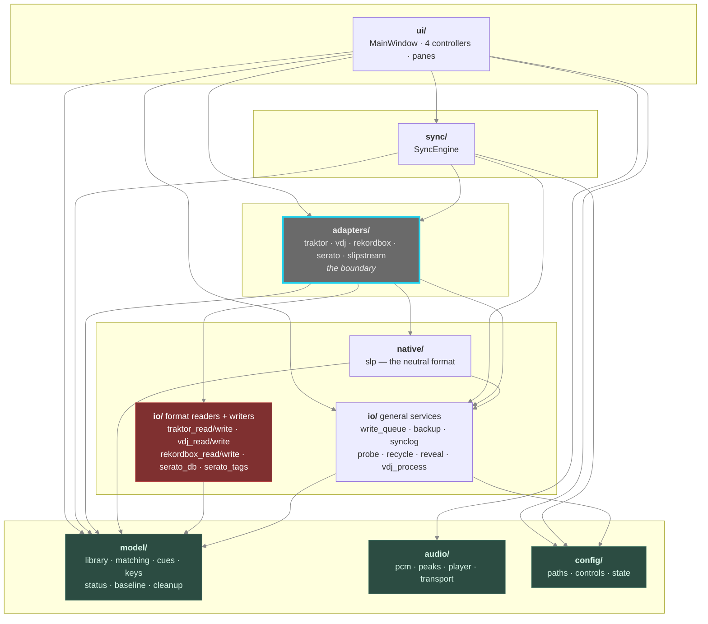
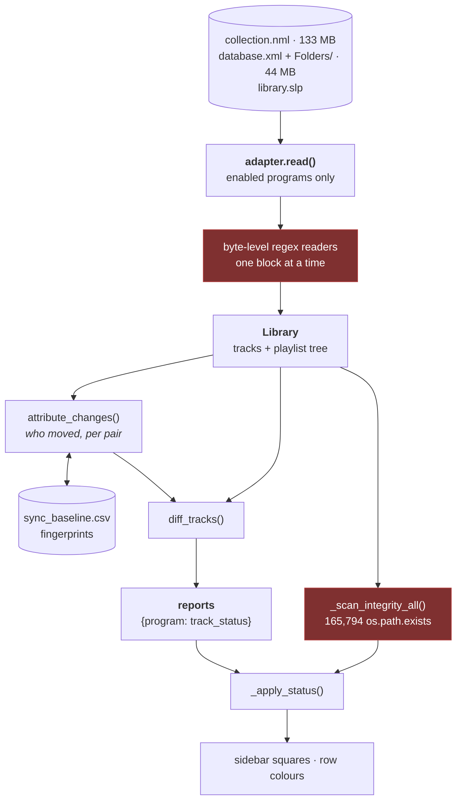
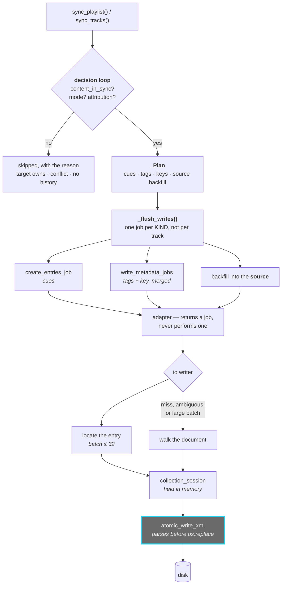
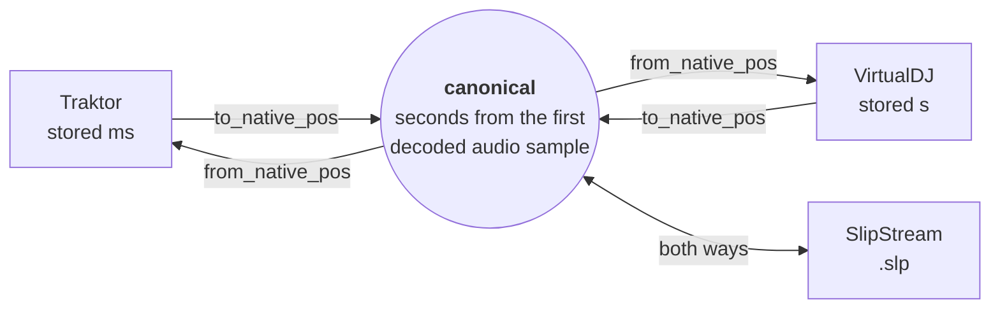
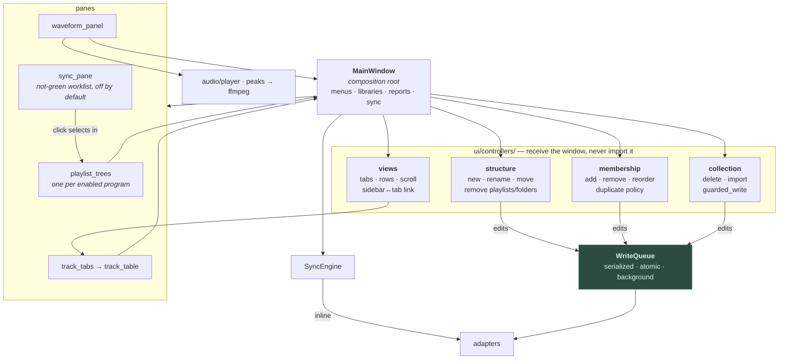

# SlipStreamIO — how it is wired

Four views of the same program: what the packages are and which way they depend,
what happens between launching and a coloured square, what happens between
clicking Sync and bytes on disk, and how the window is put together.

`HANDOFF.md` is the reference for *rules*; this is the shape they sit in.

> Every arrow here was derived from the source, not from memory. The package
> graph below is what the imports actually say.

---

## 1. Packages, and the one boundary that matters

Arrows point the way imports run — `ui` depends on `sync`, not the reverse.

**`model/`, `audio/` and `config/` import nothing from other packages** (only
siblings within themselves). They are the bottom, and everything is allowed to
depend on them.

**Nothing outside `adapters/` touches a format reader or writer.** That is the
rule the whole design rests on: add a program by adding an adapter, and no
sidebar, menu, diff or sync has to learn about it. If you find yourself writing
`if source == VDJ` outside `adapters/`, the thing you want is an adapter method.
(A few pre-adapter leftovers still do — `io/backup.py`, one check in
`controllers/membership.py`, two defaults in `MainWindow`; `HANDOFF.md` lists
them. They are debt, not precedent.)

**`io/` is two different things**, which is why the rule is not simply "io is
adapters-only":

| kind | modules | who may import |
|---|---|---|
| format readers/writers | `traktor_read`, `traktor_write`, `vdj_read`, `vdj_write`, `rekordbox_read`, `rekordbox_write`, `serato_db`, `serato_tags` | **`adapters/` only** |
| general services | `write_queue`, `backup`, `synclog`, `probe`, `recycle`, `reveal`, `vdj_process` | anyone |

A service knows nothing about any music program's format; a reader is nothing
but that knowledge.

**`ui/controllers/` never imports `main_window`.** Each controller receives the
window at runtime instead, which is what keeps the import graph acyclic while
still letting them reach shared state.

---

## 2. Launch and Refresh — from files to coloured squares

**The parse dominates, not the disk.** Reading 133 MB off disk takes 0.04 s;
turning its 83,427 `<ENTRY>` blocks into objects takes ~11 s. The integrity scan
adds ~7 s of stat calls. A full refresh on that pair is ~30 s, which is why a
track sync no longer does one — see §3.

**It runs cooperatively on the main thread**, yielding every ~128 items, with
the garbage collector off for the duration. A worker thread does not help: the
GIL starves the main-thread audio pull, which feeds a deliberately tiny 20 ms
buffer, and playback crackles for the whole reload.

---

## 3. A sync run — decide, plan, write once

**The loop only decides.** Writing used to happen inside it, once per track, and
each write walked the whole document to find its one entry — O(tracks × entries),
which was the entire runtime.

**One job per kind, per run.** Not per track: finding a single `<Song>` means
visiting all 82,366 of them. A key write *is* a metadata write with
program-specific spelling, so the two are merged into one pass.

**A small batch skips the walk entirely**, searching for the attribute the
writer itself would emit. It falls back to the walk on anything it will not
vouch for — a name it cannot find, one that appears twice, a key that disagrees —
so it can only ever be wrong by being slow.

**Nothing malformed reaches disk.** `atomic_write_xml` parses the exact string
it is about to store and refuses to replace the file otherwise.

### Positions are converted through a neutral timeline

Each adapter declares only how *its* numbers relate to that one timeline, so a
third program needs no knowledge of the first two. The Class-A correction
(`0.051536 s`, applied only when `ffprobe` reports a non-zero container
`start_time`) lives in the Traktor adapter, because that is whose numbers it
describes.

---

## 4. How the window is put together

**Edits are queued; sync writes are not.** A membership or metadata edit mutates
the in-memory model, refreshes every view of it, and writes on the background
queue — no reload, no interrupted playback, no frozen UI. A sync calls the
adapters' jobs inline, because the busy overlay and the refresh afterwards both
assume the writes have landed.

**The needs-sync pane is a view of the sidebar, not a second diff.** The window
feeds it the same status functions the squares were painted with, and a click
selects the playlist in its sidebar tree, so the pane can never disagree with
the sidebar or act on a playlist by a different path.

**The delegators on `MainWindow` are its public API.** The suite is bolted to its
private surface across hundreds of call sites, and cross-controller calls route
through the window too, so every call site reads the same. Deleting one silently
breaks tests it is not obviously connected to.

---

## The rules, in one place

| | |
|---|---|
| **Adapters own program identity** | nothing outside `adapters/` branches on which program it is |
| **Writes return jobs** | the caller decides when and on which thread |
| **Text-surgical** | a collection edit is a regex scoped to one entry; the rest of the file survives byte-for-byte |
| **Never store what will not parse** | `atomic_write_xml` checks before `os.replace` |
| **Memory never claims more than disk** | a write reports whether it landed; only then is the in-memory copy updated |
| **Decode entities exactly once** | at the point raw XML text is captured — never in `matching.path_key` |
| **Positions are canonical** | `source → native → target`, never a pairwise special case |
| **Never a permanent delete** | files go to the Recycle Bin |
| **Audio files: Serato's frames only** | verified on a copy, swapped in, old frames backed up first |
| **Snapshot before destroying** | `guarded_write` backs up every library file `Paths` names first |
| **Close VirtualDJ before writing** | it rewrites its database on exit and would clobber the edit |

Each is stated with its consequences in `HANDOFF.md`.
